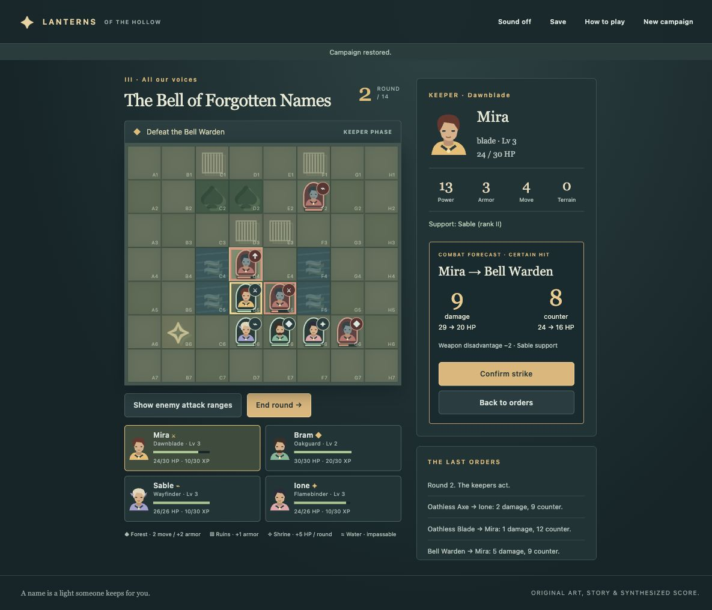

# Lanterns of the Hollow

An original turn-based tactical RPG about four friends carrying stolen names home through a fogbound valley. Inspired by the tactical formation and ally-support ideas of Fire Emblem: Awakening; every character, story, map, illustration and musical phrase here is original.

A complete compact campaign: rout the Ash Orchard, rekindle two watchfires, then defeat the Bell Warden and hear the ending. Four distinct roles, weighted grid movement, terrain defense, a weapon triangle, exact combat forecasts, adjacent bond support, deterministic levels and between-battle training create the choices.



## Play locally

Requires Node.js 24 and npm. No account, API key, paid service or public deployment is used.

```sh
npm ci
npm run build
npm run launch
```

Open **http://127.0.0.1:5195**. The launcher starts a detached, session-only localhost server, checks HTTP 200, and writes `server.log` and `.server.pid`. It refuses to replace a server already on that port. There is no login or boot autostart. When the server has stopped, restart with `npm run launch`. Choose another free port with `PORT=5196 npm run launch` if needed. `npm start` is the foreground alternative. Development: `npm run dev`.

The app needs an HTTP server; opening the source HTML as a direct file is not supported.

## Orders and rules

Select an ally, select a blue movement square, then attack, heal, guard, wait or light a beacon. Click an enemy for an exact damage/counter forecast; Confirm strike commits it. Inspect an out-of-range enemy and return with Back to orders. A provisional move can be undone with Cancel or Escape. An action consumes the ally's round. End round lets the enemies move and attack.

- Forest: movement cost 2, defense +2. Ruins: defense +1. Water: impassable. Shrine: heal 5 at the next allied round. Occupied squares block passage.
- Blade beats axe, axe beats lance, lance beats blade: power +2/-2. Bow attacks exactly at distance 2; other weapons attack at distance 1. Ione also heals up to 9 HP within 2 tiles.
- Adjacent living allies grant +1 power and +1 defense. Supported attacks strengthen persistent bonds. Rank I at 2 points, rank II at 4; rank II raises support power to +2. Multiple supporters do not stack the stat bonus.
- Every 30 XP adds +2 maximum HP and +1 power. Growth does not change current combat HP. Each camp offers one +30 XP training choice. Allies begin the next chapter fully healed.
- **No permadeath.** Fallen allies sit out the battle and recover afterward. Mira falling or the chapter round limit expiring causes defeat. Retry restores the chapter-start army and bonds, including XP, so failed attempts cannot farm progression.
- Autosaves after every order in this browser's local storage. Reload restores provisional movement and resumes an interrupted enemy phase once. New campaign asks before replacing the save.

The enemy attack overlay shows attacks from current squares; enemies can move before striking. All hits are certain. There are no random misses or criticals.

## Verification

```sh
npm run check
npm audit --audit-level=moderate
```

22 targeted public-domain tests cover movement costs/blocking, forecast outcomes, weapon and support rules, heal range, command locking/repeated actions, cancellation, enemy phase, defeat/retry, training, beacons, ending and save validation. Strict TypeScript and production build are included. GitHub Actions runs these checks and the dependency audit.

The complete campaign and ending were played **twice in the user's Mac Chrome through normal visible controls**. Additional checks included intentional defeat/retry, fallen units, interrupted enemy-phase reload, exact forecast outcomes including level growth, rank-II support, camp and chapter-story reload, save/reset, invalid moves, repeated clicks, Escape, enemy inspection and desktop/mobile/tablet screenshots. Details and honest limits: [QA record](docs/qa.md), [independent reviews](docs/reviews.md).

## Implementation

Vite + strict TypeScript; pure combat/campaign domain, DOM grid interface, locally authored SVG art and Web Audio score. No runtime dependencies or remote assets. [Specification](docs/spec.md), [glossary](GLOSSARY.md), [decision](docs/adr/0001-deterministic-recoverable-campaign.md).

The workflow applied Matt Pocock's [Grill with Docs](https://github.com/mattpocock/skills/blob/main/skills/engineering/grill-with-docs/SKILL.md) and [Implement](https://github.com/mattpocock/skills/blob/main/skills/engineering/implement/SKILL.md), plus their local domain modeling, TDD and independent code-review dependencies. Design choices were delegated; no interactive interview was claimed.
